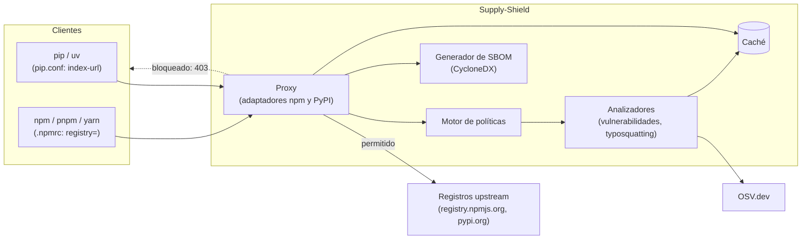

# Arquitectura

Supply-Shield se ubica entre los clientes de paquetes del equipo y los registros públicos. Funciona como **registry mirror**: los clientes lo usan como si fuera el registro (ver [ADR 0002](adr/0002-registry-mirror-instead-of-mitm-proxy.md)).

> Este documento describe la arquitectura objetivo. Hoy están la aplicación base, los endpoints de salud, los modelos compartidos (`core/`), la caché en memoria y la lista de paquetes populares (`data/popular/`) que usará el detector de typosquatting. Los detectores, el proxy y la base de datos todavía no.

## Vista de alto nivel

## Flujo de una solicitud

1. El cliente pide un paquete al proxy como si fuera el registro.
2. El adaptador del ecosistema (`proxy/npm` o `proxy/pypi`) identifica el paquete y la versión.
3. El motor de políticas (`policy/`) pide los hallazgos a los analizadores (`analyzers/`): vulnerabilidades conocidas en OSV.dev y similitud del nombre con paquetes populares.
4. Los resultados se guardan en la caché (`cache/`) para no repetir consultas.
5. Si la política lo permite, el proxy obtiene el recurso del registro upstream y lo devuelve **sin modificar sus bytes**. Si no, responde con un error que explica el bloqueo.
6. Los paquetes servidos alimentan la generación de SBOMs (`sbom/`).

## Componentes

| Módulo                               | Responsabilidad                                              |
| ------------------------------------ | ------------------------------------------------------------ |
| `supply_shield.main`                 | Factory `create_app()` y registro de routers                 |
| `supply_shield.config`               | `Settings`: única fuente de configuración (`SUPPLY_SHIELD_*`) |
| `supply_shield.logging`              | Logs estructurados (JSON en producción, consola en desarrollo) |
| `supply_shield.api`                  | Endpoints propios del servicio: `/healthz`, `/readyz`        |
| `supply_shield.proxy`                | Adaptadores de registro para npm y PyPI                      |
| `supply_shield.analyzers`            | Vulnerabilidades (OSV.dev) y typosquatting                   |
| `supply_shield.policy`               | Decisión de permitir o bloquear                              |
| `supply_shield.core`                 | Modelos compartidos: paquete, hallazgo y decisión            |
| `supply_shield.cache`                | Caché en memoria (LRU y TTL); Redis la puede reemplazar      |
| `supply_shield.sbom`                 | SBOM en CycloneDX                                            |

## Principios

- **Integridad de artefactos**: el proxy nunca altera los bytes de un artefacto descargado.
- **Configuración centralizada**: todo sale de `Settings`.
- **Sin estado externo por ahora**: no hay bases de datos; se evaluarán en un ADR posterior.
