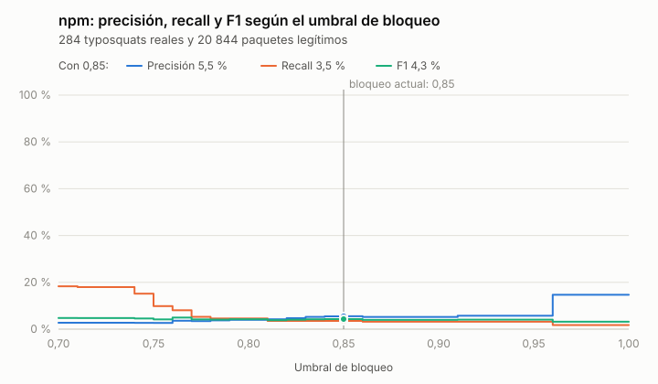
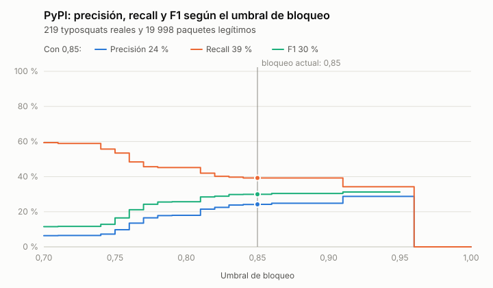
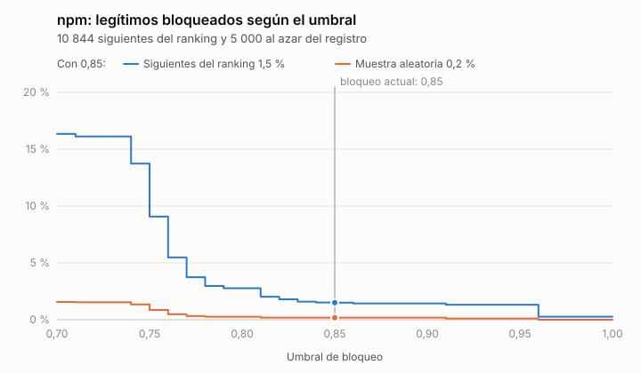
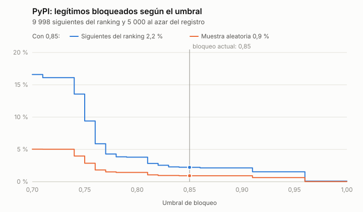

# Medición del detector de typosquatting (D4-6)

Este informe mide cuántos typosquats reales bloquea el detector (D4-4, [ADR 0008](../adr/0008-typosquatting-detector.md)) y cuántos paquetes legítimos bloquea por error. Con esos datos se elige el umbral de bloqueo ([ADR 0012](../adr/0012-typosquatting-threshold-measured.md)).

Las tablas completas están en [`typosquatting/resumen.md`](typosquatting/resumen.md), los datos por umbral en [`typosquatting/metricas.csv`](typosquatting/metricas.csv) y cada nombre puntuado en [`typosquatting/detalle.csv`](typosquatting/detalle.csv). Todo se regenera con un comando ([Reproducir](#reproducir)).

## Resumen

- **El umbral de bloqueo se queda en 0,85 (`high`).** Entre 0,83 y 0,95 el F1 casi no cambia (de 18,2 % a 18,6 %). Dentro de ese rango, 0,85 es el umbral que más typosquats bloquea. Bajarlo cuesta mucho más de lo que gana: con 0,80 se bloquean 16 typosquats más y 325 paquetes legítimos más.
- **Ningún paquete de la lista popular se bloquea** (0 de 10 000), como exige D4-4.
- **Con 0,85 se bloquea el 1,9 % de los legítimos que siguen al top 5 000** (puestos 5 001 a ~15 000) y el 0,5 % de una muestra al azar del registro.
- **El recall es bajo: 19 % de 503 typosquats reales.** El umbral no lo explica:
  - El 35 % imita a un paquete que no está en la lista popular, y el detector no tiene con qué compararlo.
  - En npm, la mayoría de los ataques recientes son *combosquatting*: el nombre real más otra palabra (`chalk-core`, `typescipt-cli`). El detector compara nombres completos y no los ve.
  - En PyPI, donde predominan los errores de tipeo clásicos (`requessts`), bloquea el 54 % de los que imitan a un paquete de la lista.
- **Cuando bloquea, acierta el objetivo:** 95 de 96 typosquats bloqueados se relacionan con el paquete que de verdad imitan.

## Qué se midió

El detector exactamente como corre en el servicio: las listas de [`data/popular/`](../../data/popular/README.md), la [lista de permitidos](../../data/typosquatting/allowlist.yaml), los pesos actuales y los umbrales de `Settings`. Se puntuó cada nombre una sola vez con `TyposquattingAnalyzer.match` y se contó qué pasaría con cada umbral de bloqueo entre 0,60 y 1,00, en pasos de 0,01.

- **Precisión:** de lo que se bloquea, qué parte es typosquat.
- **Recall:** de los typosquats, qué parte se bloquea.
- **Recall en alcance:** lo mismo, solo con los typosquats cuyo paquete imitado está en la lista popular. Es lo que el diseño puede detectar.
- **FP de un grupo:** qué parte de ese grupo de legítimos se bloquearía.

Puntuar los 42 100 nombres tomó unos 60 s (1,4 ms por nombre en promedio).

## Dataset

Lo arma [`eval/typosquatting/build_dataset.py`](../../eval/typosquatting/build_dataset.py) con fuentes fijadas a un commit o una versión; el detalle está en [`sources.json`](../../eval/typosquatting/dataset/sources.json).

| Grupo | npm | PyPI | De dónde sale |
| --- | --- | --- | --- |
| Typosquats con paquete imitado | 284 | 219 | Paquetes maliciosos de [OpenSSF malicious-packages](https://github.com/ossf/malicious-packages) cuyo aviso dice "typosquat" |
| Typosquats sin paquete imitado identificable | 411 | 344 | Los mismos avisos; no cuentan en las métricas |
| Legítimos: la lista popular | 5 000 | 5 000 | `data/popular/` |
| Legítimos: siguientes del ranking | 10 844 | 9 998 | Las mismas fuentes que `data/popular/`, después del puesto 5 000 |
| Legítimos: muestra aleatoria | 5 000 | 5 000 | Todo el registro: `all-the-package-names` en npm y el índice simple en PyPI |

**Positivos.** De los avisos de OpenSSF se tomaron los que describen el nombre como typosquat: 1 258 nombres. Ese texto es la etiqueta, y no depende del detector. Después se revisó a mano cada nombre para anotar qué paquete imita. Se anotó cuando el nombre o el aviso lo identifican sin ambigüedad: un error de tipeo, un cambio de separadores o de `@scope`, o el nombre real con palabras agregadas.

Quedaron sin objetivo 755 nombres: casi todos son nombres internos de empresas (*dependency confusion*), nombres al azar, paquetes de prueba o imitaciones de una marca sin un paquete concreto. La revisión vive en [`labels.csv`](../../eval/typosquatting/labels.csv) y se hizo sin mirar qué responde el detector.

**Negativos.** Paquetes publicados que nadie reportó como maliciosos. Se excluye de ellos cualquier nombre que aparezca en OpenSSF o en el [dataset de Datadog](https://github.com/DataDog/malicious-software-packages-dataset). De Datadog solo se descargaron los `manifest.json`, nunca muestras de malware.

- Los **siguientes del ranking** son lo que más importa: paquetes legítimos y bastante usados que no tienen la exención de la lista popular.
- La **muestra aleatoria** representa la cola larga del registro: proyectos personales, paquetes abandonados y algo de spam.

Backstabber's Knife Collection no se usó porque solo se entrega a pedido.

## Resultados

### Umbrales configurados

| Umbral | Precisión | Recall | F1 | Recall en alcance | FP lista popular | FP siguientes | FP aleatorios |
| --- | --- | --- | --- | --- | --- | --- | --- |
| npm, 0,85 (bloquea) | 5,5 % | 3,5 % | 4,3 % | 6 % | 0 % | 1,5 % | 0,2 % |
| PyPI, 0,85 (bloquea) | 24 % | 39 % | 30 % | 54 % | 0 % | 2,2 % | 0,9 % |
| **Ambos, 0,85 (bloquea)** | **18 %** | **19 %** | **18 %** | **30 %** | **0 %** | **1,9 %** | **0,5 %** |
| Ambos, 0,70 (`medium`, solo registra) | 4,6 % | 36 % | 8,2 % | 56 % | 0 % | 16 % | 3,3 % |
| Ambos, 0,95 (`critical`) | 20 % | 17 % | 18 % | 26 % | 0 % | 1,4 % | 0,4 % |

La precisión depende de la mezcla del dataset: aquí hay un typosquat por cada 80 legítimos. En la práctica, los typosquats son mucho más raros entre los paquetes que se piden, así que la precisión real sería menor. Para operar el detector, el dato útil es la tasa de FP de cada grupo: cuántos paquetes legítimos de cada tipo se bloquean.

### Precisión, recall y F1 según el umbral





Las curvas son escalonadas porque los puntajes forman mesetas: 0,90 es una edición; 0,95, separadores, letras parecidas o una edición que también coincide en Jaro-Winkler; 0,80, un afijo; 0,70, solo el número final. Por eso mover el umbral dentro de una meseta no cambia nada.

| Umbral (ambos) | Typosquats bloqueados | Legítimos bloqueados | Recall | FP siguientes | F1 |
| --- | --- | --- | --- | --- | --- |
| 0,75 | 145 | 2 110 | 29 % | 9,2 % | 10,5 % |
| 0,80 | 112 | 766 | 22 % | 3,3 % | 16,2 % |
| **0,85** | **96** | **441** | **19 %** | **1,9 %** | **18,5 %** |
| 0,90 | 95 | 424 | 19 % | 1,8 % | 18,6 % |
| 0,95 | 84 | 334 | 17 % | 1,4 % | 18,2 % |

### Legítimos bloqueados según el umbral





Por debajo de 0,80 los falsos positivos se disparan: con 0,75 se bloquea uno de cada once paquetes de los puestos 5 001 a 15 000.

### Qué técnica decide cada bloqueo (0,85)

| Técnica más fuerte | Typosquats | FP siguientes | FP aleatorios |
| --- | --- | --- | --- |
| `edit_distance` | 88 | 280 | 54 |
| `scope` | 7 | 58 | 0 |
| `separators` | 0 | 26 | 1 |
| `affix` | 1 | 21 | 0 |
| `confusables` | 0 | 1 | 0 |

- **`scope`:** los 7 aciertos son scopes mal escritos (`@anfular/core` por `@angular/core`). En cambio, 54 de sus 58 falsos positivos son nombres viejos sin scope que el proyecto después movió a uno: `babel-traverse` por `@babel/traverse`, `rollup-plugin-inject` por `@rollup/plugin-inject`.
- **`separators`:** no tiene ningún acierto, pero no es evidencia en su contra. Los ataques clásicos de ese tipo (`crossenv`, 2017) no traen la palabra "typosquat" en su aviso, así que este dataset casi no los incluye (ver [Límites](#límites)).
- **El número final (`numbered_variant`, 0,70):** solo registra, y así debe seguir. Detecta 2 typosquats (`passport811`, `telethon2`) a cambio de 74 legítimos. Responde la pregunta que dejó abierta el ADR 0008: no hay que subir su peso.

### Por qué se escapan los typosquats (0,85)

Esta es una clasificación descriptiva de la forma de cada nombre no bloqueado, respecto del paquete que imita:

| Forma del nombre | npm | PyPI |
| --- | --- | --- |
| El paquete imitado no está en la lista popular | 118 | 60 |
| El nombre real más otras palabras (`chalk-core`, `axios-fast`) | 81 | 27 |
| Una palabra del nombre real, a veces mal escrita, más otras (`typescipt-cli`, `comander-cli`) | 39 | 18 |
| El nombre, igual o con un error, bajo un `@scope` ajeno (`@dervix/ws`) | 14 | 0 |
| Se parece, pero el puntaje no llega a 0,85 (`axiosqqq` 0,74, `marshmellows` 0,81) | 7 | 18 |
| Otra forma (`lodahsjs`, `reqzest`) | 15 | 10 |

- En npm, 120 de los 156 typosquats que imitan a un paquete de la lista son *combosquats*. El detector compara el nombre completo, no sus palabras.
- De los 178 que imitan a un paquete fuera de la lista, 94 apuntan a paquetes de los puestos 5 001 a ~15 000 de las mismas fuentes. Ejemplos: `chai-as-promised` (puesto 6 856 en npm, con 26 imitaciones en el dataset), `@solana/web3.js`, `hardhat` y `pyrogram`. El resto imita a paquetes que no figuran en el ranking (`@wordpress/env`, `fuels`) o a nombres de proyectos internos (`neurst`, `lightseq`).

## Elección del umbral

**Se mantiene el bloqueo desde 0,85 y los demás umbrales (0,60 / 0,70 / 0,95).**

- **El F1 no distingue entre los candidatos.** El mejor F1 de ambos ecosistemas juntos (18,6 %, entre 0,86 y 0,90) supera al de 0,85 por un typosquat y 17 legítimos. Esa diferencia es menor que el ruido de las etiquetas.
- **Con F1 empatado, gana el recall.** Es un control de seguridad: un typosquat que pasa puede ejecutar código en la máquina que lo instala. Un legítimo bloqueado tiene arreglo inmediato con una excepción o la lista de permitidos ([policy.md](../policy.md#excepciones)).
- **Bajar el umbral no compensa.**
  - Con 0,80 entran los afijos solos y las dos ediciones que además coinciden en Jaro-Winkler: 16 typosquats más por 325 legítimos más.
  - Con 0,75 entran también las dos ediciones solas y más casos de Jaro-Winkler: 49 más por 1 669 más.
- **Subirlo a 0,95 tampoco.** Deja pasar 12 typosquats de una sola edición, como `loquru` o `rlask`, para ahorrar 107 legítimos.

Por separado, PyPI tendría su mejor F1 en 0,95 y npm en 0,76. Esos números salen de pocos aciertos (en npm, 10 a 23 typosquats bloqueados) y no justifican umbrales por ecosistema.

## Qué mejoraría el detector

Ninguno de estos cambios es de umbral y ninguno entra en D4-6. El arnés de medición permite comparar cada propuesta contra estos números antes de adoptarla.

1. **Combosquatting** (el hueco más grande en npm): comparar también las palabras del nombre, por ejemplo `typescipt` dentro de `typescipt-cli`.
   - Puede recuperar buena parte de los 120 casos de npm.
   - El riesgo son los falsos positivos: miles de paquetes legítimos se llaman `<popular>-<algo>` (`eslint-plugin-*`, `react-*`).
2. **Separar la señal `scope`.** Quitar o poner un scope causa 54 de los 163 falsos positivos de npm entre los siguientes del ranking, y no tiene aciertos aquí. Un scope mal escrito explica los 7 aciertos.
   - No basta con bajar su peso: la bonificación por coincidir con Jaro-Winkler y una edición mantiene esos casos sobre 0,85.
3. **Más alcance para la lista.** Comparar contra los ~15 000 nombres de las fuentes pondría en alcance 94 typosquats más.
   - Habría que medir cuántos falsos positivos agrega, con negativos posteriores al puesto 15 000.
4. **Menos falsos positivos en los puestos 5 001 a 15 000.** Una opción es eximir también esos nombres: ninguno de los typosquats del dataset está en ese tramo.
   - La exención solo sería segura si la cuarentena de entrantes ([ADR 0011](../adr/0011-popular-list-newcomer-quarantine.md)) cubriera también ese tramo. Si no, la lista exenta queda más expuesta a las descargas infladas.

## Límites

- **Sesgo de época en los positivos.** Solo cuentan los avisos que dicen "typosquat". El 98 % se publicó entre 2024 y 2026 (el 72 %, en 2026), y la mayoría viene de Amazon Inspector, kam193, GitHub y ReversingLabs. Los ataques clásicos de separadores o letras parecidas, más antiguos, casi no aparecen. Ese tipo de typosquat estaría subrepresentado, y su recall real podría ser mayor que el medido.
- **Campañas.** Unas pocas campañas pesan mucho: 34 imitaciones de `requests` en PyPI, 26 de `chai-as-promised` y 14 de `typescript` en npm. Las tasas valen para esta mezcla de ataques.
- **Etiquetas revisadas por un asistente.**
  - La revisión de `labels.csv` la hizo el asistente de código del equipo, sin ver la respuesta del detector. Conviene que una persona audite una muestra.
  - En 3 nombres de PyPI la revisión no encontró objetivo y el detector sí: `distpro` por `distro`, `hashidf` por `hashids` y `vercel-runtime-python` por `vercel-runtime`. Contarlos subiría el recall de PyPI de 39 % a 40 %.
- **Negativos presuntos.** Que nadie haya reportado un paquete no prueba que sea legítimo. Algunos "falsos positivos" de la muestra aleatoria parecen ataques no reportados (`wexpress`, `cydantic`), así que la tasa de FP medida es una cota superior.
- **Listas y fuentes.**
  - La medición usa las listas de `data/popular/` de este commit: la de npm sale de `npm-high-impact` 1.13.0, de junio de 2026.
  - 33 objetivos de npm no figuran en ninguna de las 15 916 posiciones de esa fuente, entre ellos paquetes recientes como `@modelcontextprotocol/server-postgres`. Una lista más reciente podría cambiar el alcance, pero este dataset no separa la edad de la lista del corte en 5 000. Es la pregunta que dejó abierta el [ADR 0004](../adr/0004-popular-package-sources.md).
  - El índice simple de PyPI no se puede fijar a una versión: la muestra aleatoria de PyPI se regenera igual solo mientras el índice no cambie.
- **Nombres maliciosos dentro de la lista popular.** OpenSSF o Datadog listan 58 nombres de la lista de npm y 7 de la de PyPI, por versiones comprometidas de paquetes legítimos (TanStack, Nx, `litellm`, `ultralytics`). Ninguno está declarado typosquat, y esos casos los cubre el detector de malware (D3-4), no este.

## Reproducir

```bash
# Medir con el dataset del repo (sin red, ~1 min). Reescribe docs/results/typosquatting/.
uv run python eval/typosquatting/evaluate.py

# Rearmar el dataset desde las fuentes fijadas (~2 min, ~125 MB de descargas).
uv run python eval/typosquatting/build_dataset.py --pending pendientes.csv
```

Si cambian los pesos, los umbrales o las listas populares, vuelve a correr la medición y actualiza este informe. Para usar una versión más nueva de las fuentes, cambia las constantes de `build_dataset.py`, revisa los typosquats nuevos que deje `--pending` y agrégalos a `labels.csv`. Los detalles están en [`eval/typosquatting/README.md`](../../eval/typosquatting/README.md).
